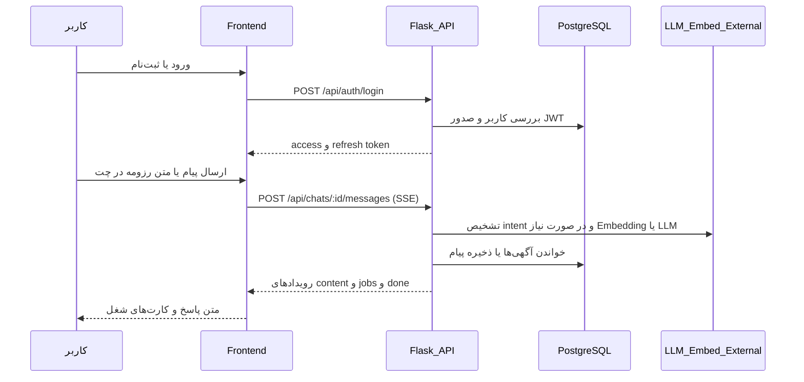
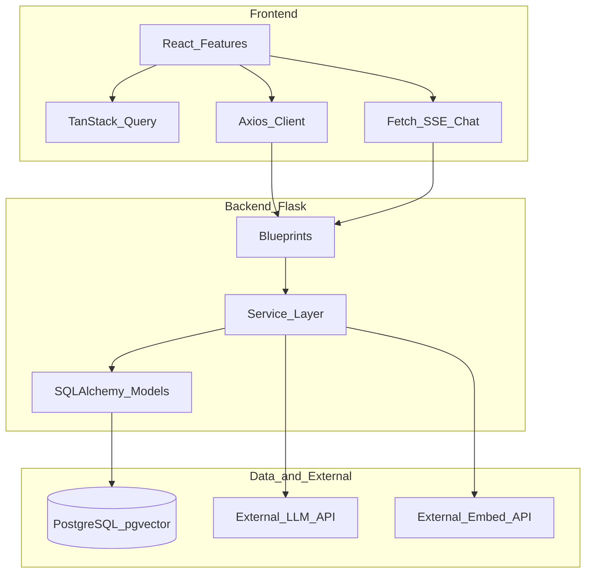
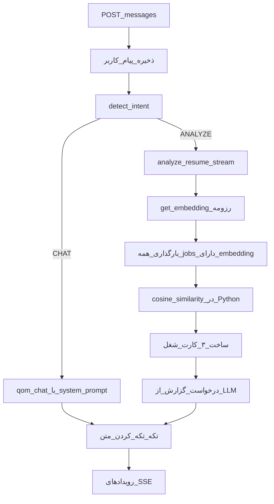
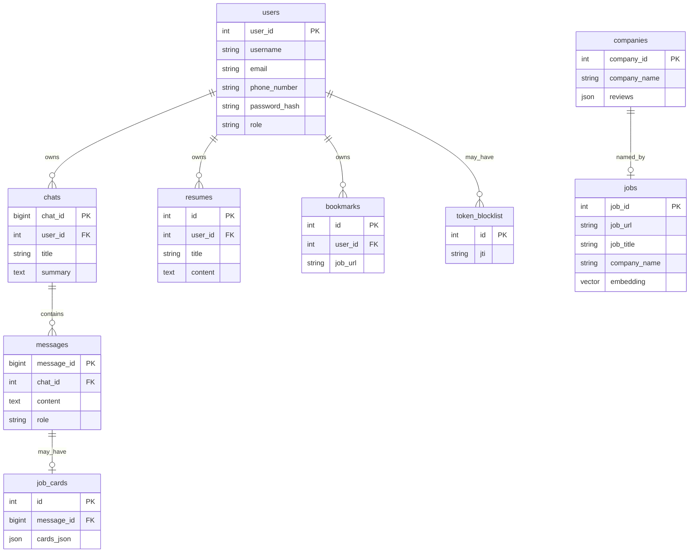

# دستیار هوشمند کاریابی «سکه»

مستندات فنی مخزن [smartsoftwarelab/sekeh-ai](https://github.com/smartsoftwarelab/sekeh-ai) برای توسعه‌دهندگان و مشارکت‌کنندگان.

> [!WARNING]
> **محدودیت حیاتی زیرساخت هوش مصنوعی:** این پروژه در وضعیت فعلی فاقد زیرساخت کامل و عملیاتی برای یکپارچه‌سازی مدل‌های زبانی بزرگ (LLM) و تولید و مدیریت Embedding است. بنابراین، قابلیت‌های وابسته به هوش مصنوعی و جستجوی معنایی را نمی‌توان به‌عنوان قابلیت‌های کامل و آماده بهره‌برداری در نظر گرفت. برای توسعه و تکمیل این سامانه، لازم است مخزن پروژه Clone شده و بخش‌های مرتبط با معماری، زیرساخت هوش مصنوعی و ارتباط میان سرویس‌ها مورد بازبینی و Refactor قرار گیرند.
>
> جزئیات فنی این محدودیت در بخش [محدودیت حیاتی: LLM و Embedding](#۹-محدودیت-حیاتی-llm-و-embedding) آمده است.

## فهرست مطالب

- [۱. معرفی پروژه](#۱-معرفی-پروژه)
- [۲. قابلیت‌ها و وضعیت پیاده‌سازی](#۲-قابلیت‌ها-و-وضعیت-پیاده‌سازی)
- [۳. پشته فناوری](#۳-پشته-فناوری)
- [۴. معماری پروژه](#۴-معماری-پروژه)
- [۵. ساختار پوشه‌ها](#۵-ساختار-پوشه‌ها)
- [۶. نصب و اجرای محلی](#۶-نصب-و-اجرای-محلی)
- [۷. مستندات API](#۷-مستندات-api)
- [۸. پایگاه‌داده و مدل‌ها](#۸-پایگاه‌داده-و-مدل‌ها)
- [۹. محدودیت حیاتی: LLM و Embedding](#۹-محدودیت-حیاتی-llm-و-embedding)
- [۱۰. امنیت و پیکربندی](#۱۰-امنیت-و-پیکربندی)
- [۱۱. وضعیت توسعه و نقشه راه](#۱۱-وضعیت-توسعه-و-نقشه-راه)
- [۱۲. مشارکت در پروژه](#۱۲-مشارکت-در-پروژه)
- [۱۳. اسکریپت‌ها، استقرار و مجوز](#۱۳-اسکریپت‌ها-استقرار-و-مجوز)
- [۱۴. درباره پروژه](#۱۴-درباره-پروژه)

---

## ۱. معرفی پروژه

**سکه** سامانه‌ای برای مشاوره هوشمند کاریابی است که با هدف کمک به جویندگان کار در بازار ایران طراحی شده است. مسئله اصلی این است که پس از آماده‌سازی رزومه، یافتن آگهی‌های شغلی هم‌خوان با مهارت‌ها دشوار است.

در طراحی هدفمند پروژه، کاربر رزومه یا پیام خود را در محیط گفتگو وارد می‌کند؛ سامانه قصد پیام را تشخیص می‌دهد؛ در مسیر تحلیل، شباهت معنایی با آگهی‌های ذخیره‌شده محاسبه می‌شود؛ سپس پیشنهاد شغل (تا ۳ مورد) همراه درصد تطابق و گزارش تحلیلی ارائه می‌گردد.

**کاربران هدف:**

| گروه | نقش در سامانه |
|------|----------------|
| جوینده کار | ثبت‌نام، مدیریت رزومه متنی، گفتگو، مشاهده پیشنهاد شغل، بوک‌مارک |
| مدیر سامانه | مشاهده آمار، مدیریت کاربران و آگهی‌ها (نقش `admin`) |
| توسعه‌دهنده | Clone، اجرای محلی، تکمیل زیرساخت AI و Refactor |

> [!NOTE]
> نسخه وب روی GitHub Pages در آدرس [https://smartsoftwarelab.github.io/sekeh-ai/](https://smartsoftwarelab.github.io/sekeh-ai/) قابل دسترسی است. این میزبانی فقط فرانت‌اند استاتیک را پوشش می‌دهد؛ عملکرد وابسته به API و سرویس‌های خارجی LLM/Embedding است و بدون آن‌ها قابلیت‌های هوشمند عملیاتی نیستند.

### جریان کلی تعامل کاربر



---

## ۲. قابلیت‌ها و وضعیت پیاده‌سازی

وضعیت‌ها بر اساس کد موجود در مخزن تعیین شده‌اند، نه بر اساس توصیف محصول.

| قابلیت | توضیح | محل مرتبط | وضعیت |
|--------|--------|-----------|--------|
| ثبت‌نام و ورود JWT | ثبت‌نام با نام‌کاربری و رمز؛ ورود و دریافت access/refresh | `front-end/src/features/auth`، `backend-end/chat_api/routes/auth.py` | پیاده‌سازی شده |
| تمدید و خروج توکن | Refresh روی 401؛ Logout با blocklist | `client.ts`، `auth.py`، `TokenBlocklist` | پیاده‌سازی شده |
| پروفایل کاربر | مشاهده، ویرایش، تغییر رمز، حذف حساب | `features/profile`، `routes/users.py` | پیاده‌سازی شده |
| مدیریت چت | ایجاد، فهرست، حذف، تغییر عنوان | `features/chat`، `routes/chat.py` | پیاده‌سازی شده |
| گفتگوی SSE | ارسال پیام و دریافت پاسخ به‌صورت رویداد SSE | `useChatStream.ts`، `routes/message.py` | پیاده‌سازی شده (استریم واقعی LLM ناقص است؛ متن پس از پاسخ کامل تکه‌تکه می‌شود) |
| رزومه متنی | CRUD عنوان و محتوای متنی (بدون آپلود فایل) | `features/resume`، `routes/resume.py` | پیاده‌سازی شده |
| انتخاب رزومه در چت | درج محتوای رزومه در ورودی پیام | `ResumePickerDialog` | پیاده‌سازی شده |
| بوک‌مارک آگهی | افزودن/حذف و فهرست بوک‌مارک‌ها | `features/marks`، `routes/bookmark.py` | پیاده‌سازی شده |
| پنل ادمین | آمار، کاربران، آگهی‌ها (ویرایش/حذف) | `features/admin`، `routes/admin.py` | پیاده‌سازی شده |
| صفحه فرود پویا | محتوای فارسی + آمار زنده از API | `features/landing`، `routes/landing.py` | پیاده‌سازی شده |
| تماس با ما | صفحه ایستا (بدون فرم/API) | `features/contact` | پیاده‌سازی شده (ایستا) |
| تشخیص قصد پیام | مسیر CHAT در برابر ANALYZE | `intent_classifier.py` | پیاده‌سازی ناقص (وابسته به LLM خارجی؛ در خطا به heuristic برمی‌گردد) |
| تطابق شغل و گزارش | Embedding رزومه، امتیازدهی، کارت شغل، گزارش LLM | `resume_report.py`، `job_scoring.py`، `embeddings.py`، `qom_llm.py` | پیاده‌سازی ناقص (بدون زیرساخت عملیاتی کامل AI؛ جزئیات در بخش ۹) |
| آپلود فایل رزومه | — | — | پیاده‌سازی نشده |
| صفحه مستقل Matching | تطابق فقط از مسیر چت | — | پیاده‌سازی نشده |
| خزنده/واردکننده آگهی | پر کردن جدول `jobs` و Embeddingها | — | پیاده‌سازی نشده |
| لایک/دیسلایک پیام | UI فقط `console.log` | `ChatMessage.tsx` | پیاده‌سازی ناقص |
| تکمیل ثبت‌نام با ورود خودکار | پس از signup بدون ذخیره توکن به `/chats` می‌رود | `SignupPage.tsx` | پیاده‌سازی ناقص |
| جستجوی برداری ANN در SQL | استفاده از عملگرهای فاصله pgvector / IVFFlat / HNSW | `job_scoring.py` | پیاده‌سازی نشده (بارگذاری همه ردیف‌ها + cosine در Python) |

---

## ۳. پشته فناوری

### Frontend

| فناوری | نسخه (تقریبی از `package.json`) | کاربرد در پروژه |
|--------|----------------------------------|-----------------|
| React / React DOM | ^19.2.0 | رابط کاربری |
| TypeScript | ~5.9.3 | تایپ‌استاتیک |
| Vite | ^7.2.2 | توسعه و بیلد |
| React Router | ^7.9.6 | مسیریابی SPA با `basename` |
| Tailwind CSS | ^4.1.17 | استایل RTL |
| TanStack Query | ^5.90.21 | state سمت سرور و کش |
| Axios | ^1.13.5 | REST (به‌جز SSE چت) |
| Zustand | ^5.0.14 | نگهداری پروفایل در حافظه |
| Framer Motion / GSAP | وابستگی‌های موجود | انیمیشن |
| react-markdown | ^10.1.0 | رندر پیام‌های چت |
| Vitest / ESLint | موجود | تست واحد محدود و lint |

### Backend

| فناوری | نسخه (`requirements.txt`) | کاربرد |
|--------|---------------------------|--------|
| Flask | 3.0.0 | وب‌فریم‌ورک و API |
| Flask-SQLAlchemy | 3.1.1 | ORM |
| Flask-JWT-Extended | 4.6.0 | احراز هویت JWT |
| Flask-Cors | 4.0.0 | CORS برای `/api/*` |
| Flask-Bcrypt | 1.0.1 | در `requirements` و init موجود است؛ هش رمز در عمل با Werkzeug انجام می‌شود |
| Flasgger | بدون پین نسخه | Swagger UI و YAMLهای مسیرها |
| python-dotenv | 1.0.1 | بارگذاری `.env` |
| requests | بدون پین | فراخوانی HTTP به LLM و Embedding |
| numpy | بدون پین | cosine similarity |
| psycopg2 / pg8000 | بدون پین | اتصال PostgreSQL |
| pgvector | بدون پین | نوع ستون برداری در مدل Job |

### پایگاه‌داده و احراز هویت

| موضوع | فناوری |
|--------|--------|
| پایگاه‌داده | PostgreSQL |
| افزونه برداری | `vector` (در استارت‌آپ `CREATE EXTENSION IF NOT EXISTS vector`) |
| هش رمز | `werkzeug.security` |
| توکن | JWT access + refresh؛ ابطال با `token_blocklist` |
| نقش‌ها | فیلد متنی `User.role` (`user` / `admin`) |

### AI و یادگیری ماشین (وضعیت فعلی)

| جزء | آنچه در کد وجود دارد | آنچه عملیاتی کامل نیست |
|------|----------------------|-------------------------|
| LLM | کلاینت HTTP سازگار با OpenAI در `qom_llm.py` | وابستگی به سرویس خارجی؛ استریم واقعی نیست؛ بدون تضمین دسترسی/کیفیت |
| Embedding | کلاینت HTTP در `embeddings.py` | در خطا بردار صفر برمی‌گرداند؛ pipeline تولید Embedding برای آگهی‌ها در مخزن نیست |
| بازیابی | cosine روی همه آگهی‌های دارای Embedding در حافظه | جستجوی برداری ایندکس‌شده در پایگاه‌داده پیاده نشده |
| RAG | پرامپت گزارش + ۳ شغل برتر | معماری RAG کامل، کنترل کیفیت و محدودیت نرخ پیاده نشده |

### ابزار توسعه و استقرار

| ابزار | محل |
|--------|------|
| npm + Vite | `front-end/` |
| GitHub Actions Pages | `.github/workflows/deploy.yml` |
| Gunicorn | اشاره در `Procfile` (در `requirements.txt` نیست) |
| Flasgger | معمولاً مسیر `/apidocs/` |

---

## ۴. معماری پروژه

پروژه یک monorepo ساده با دو بخش مستقل است:

- `front-end/`: SPA استاتیک (React + Vite)
- `backend-end/`: REST API + SSE (Flask)

فرانت‌اند و بک‌اند جدا اجرا می‌شوند. فرانت از طریق `VITE_API_URL` به API متصل می‌شود.



### معماری Frontend

ساختار feature-based:

- `src/app`: Router، Providerها، استایل سراسری
- `src/features/*`: دامنه محصول (auth، chat، resume، marks، profile، admin، landing، contact)
- `src/shared`: کلاینت HTTP، کامپوننت‌های مشترک، هوک‌ها، ابزارها

مسیرها در `AppRouter.tsx` تعریف شده‌اند. اکثر صفحات lazy-load هستند. مسیرهای داخل `AppLayout` نیازمند توکن در `localStorage` هستند. مسیرهای `/admin/*` نیازمند `profile.role === "admin"` هستند.

### معماری Backend

کارخانه اپلیکیشن در `chat_api/__init__.py`:

1. بارگذاری `Config`
2. پیکربندی CORS و Swagger
3. init اکستنشن‌ها (`db`، `bcrypt`، `jwt`)
4. ثبت JWT loaders و blocklist
5. ثبت Blueprintها زیر `/api`
6. ایجاد افزونه `vector` و `db.create_all()`

لایه سرویس مسئولیت منطق دامنه را دارد: تشخیص intent، تولید پاسخ چت، تحلیل رزومه، امتیازدهی شغل، خلاصه‌سازی حافظه چت، تولید عنوان، نظرات شرکت، و بررسی نقش ادمین.

### چرخه درخواست پیام چت (مسیر هوشمند)



---

## ۵. ساختار پوشه‌ها

پوشه‌های تولیدشده مانند `node_modules`، `dist`، `venv` و `__pycache__` حذف شده‌اند.

```text
sekeh-ai/
├── .github/workflows/deploy.yml   # بیلد front-end و استقرار GitHub Pages
├── README.md                      # همین سند
├── front-end/
│   ├── package.json
│   ├── vite.config.ts
│   ├── .env / .env.development / .env.production
│   ├── public/
│   ├── README.md                  # قراردادهای فرانت‌اند
│   └── src/
│       ├── main.tsx
│       ├── app/                   # Router، Providers، styles
│       ├── features/              # auth, chat, resume, marks, profile, admin, landing, contact
│       └── shared/                # api client، UI، hooks، lib
└── backend-end/
    ├── app.py                     # نقطه ورود WSGI
    ├── config.py                  # خواندن متغیرهای محیطی
    ├── requirements.txt
    ├── Procfile
    ├── README.md                  # مستندات انگلیسی بک‌اند (برخی جزئیات با کد هم‌خوان نیست)
    ├── tests/                     # اسکریپت‌های دستی دود و اتصال DB
    └── chat_api/
        ├── __init__.py            # create_app
        ├── extensions.py
        ├── models/
        ├── routes/
        ├── service/
        ├── utils/
        └── docs/                  # YAMLهای Flasgger
```

---

## ۶. نصب و اجرای محلی

فرانت‌اند و بک‌اند **جداگانه** اجرا می‌شوند. فایل `.env.example` در مخزن وجود ندارد؛ متغیرهای لازم در ادامه فهرست شده‌اند. مقادیر محرمانه را Commit نکنید.

### پیش‌نیازها

- Node.js (در CI نسخه ۲۲ استفاده می‌شود)
- npm
- Python 3 (سازگار با Flask 3)
- PostgreSQL با امکان نصب افزونه `vector`
- دسترسی به سرویس‌های خارجی Chat Completions و Embeddings سازگار با OpenAI API، در صورت نیاز به مسیرهای هوشمند (بدون آن‌ها فقط بخش‌های غیر AI قابل آزمایش‌اند)

### Clone

```bash
git clone https://github.com/smartsoftwarelab/sekeh-ai.git
cd sekeh-ai
```

### Backend

```bash
cd backend-end
python -m venv venv

# Windows
venv\Scripts\activate

# Linux / macOS
# source venv/bin/activate

pip install -r requirements.txt
```

یک فایل `.env` در `backend-end/` بسازید و حداقل این متغیرها را تنظیم کنید (مقادیر نمونه نیستند؛ باید توسط شما تأمین شوند):

| متغیر | کاربرد |
|--------|--------|
| `SECRET_KEY` | کلید Flask |
| `DATABASE_URL` | URI اتصال SQLAlchemy به PostgreSQL |
| `JWT_SECRET_KEY` | امضای JWT |
| `JWT_ACCESS_MINUTES` | عمر access token (عدد) |
| `JWT_REFRESH_DAYS` | عمر refresh token (عدد) |
| `LLM_BASE_URL` | پایه URL سرویس Chat |
| `LLM_CHAT_ENDPOINT` | مسیر تکمیل چت (مثلاً `/v1/chat/completions`) |
| `LLM_API_KEY` | کلید Bearer سرویس LLM |
| `LLM_MODEL` | شناسه مدل |
| `LLM_TEMPERATURE` | عدد اعشاری |
| `LLM_MAX_TOKENS` | عدد صحیح |
| `LLM_TIMEOUT` | ثانیه |
| `EMBED_BASE_URL` | پایه URL سرویس Embedding |
| `EMBED_MODEL` | شناسه مدل Embedding |
| `EMBED_EXPECTED_DIM` | بُعد مورد انتظار بردار (مدل Job روی `Vector(1024)` است) |
| `EMBED_TIMEOUT` | ثانیه |
| `CORS_ORIGINS` | اختیاری؛ لیست مبدأها با کاما |

> [!NOTE]
> در `config.py` برای چند فیلد عددی از `int(...)` / `float(...)` روی مقدار env استفاده شده است. خالی بودن این متغیرها در زمان import باعث خطا می‌شود.

اجرای توسعه:

```bash
python app.py
```

سرور روی `0.0.0.0:5000` بالا می‌آید. در استارت‌آپ، افزونه `vector` و جداول با `db.create_all()` ساخته می‌شوند. **سیستم migration (مانند Alembic) وجود ندارد.**

اجرای production-like (در صورت نصب جداگانه gunicorn):

```bash
gunicorn --bind 0.0.0.0:5000 app:app
```

مستندات تعاملی API پس از اجرا معمولاً از طریق Flasgger در مسیر `/apidocs/` در دسترس است.

### Frontend

```bash
cd front-end
npm install
```

متغیرهای محیطی فرانت‌اند:

| فایل | متغیر | نقش |
|------|--------|------|
| `.env` | `VITE_API_URL` | پایه URL بک‌اند (با `/` انتهایی؛ کلاینت مسیر `api` را اضافه می‌کند) |
| `.env.development` | `VITE_BASE_FRONT_URL` | مقدار `/` برای توسعه |
| `.env.production` | `VITE_BASE_FRONT_URL` | مقدار `/sekeh-ai/` برای GitHub Pages |

```bash
npm run dev
```

سایر دستورات:

```bash
npm run build
npm run preview
npm run lint
npm test
```

پیش‌فرض Vite روی پورت توسعه اجرا می‌شود و در CORS بک‌اند مبدأهای `localhost:5173` مجازند.

---

## ۷. مستندات API

پایه همه مسیرها: `/api`. جزئیات بیشتر در YAMLهای `backend-end/chat_api/docs/` و UI فلَسگر موجود است.

### احراز هویت

| Method | Endpoint | Auth | کاربرد |
|--------|----------|------|--------|
| POST | `/api/auth/register` | خیر | ایجاد کاربر |
| POST | `/api/auth/login` | خیر | دریافت JWT |
| POST | `/api/auth/refresh` | Refresh JWT | access جدید |
| POST | `/api/auth/logout` | Access JWT | ابطال توکن جاری |

### کاربر

| Method | Endpoint | Auth | کاربرد |
|--------|----------|------|--------|
| GET | `/api/user/me` | Access | پروفایل |
| PATCH | `/api/user/me` | Access | ویرایش پروفایل |
| PATCH | `/api/user/me/password` | Access | تغییر رمز |
| DELETE | `/api/user/me` | Access | حذف حساب |

### چت و پیام

| Method | Endpoint | Auth | کاربرد |
|--------|----------|------|--------|
| GET | `/api/chats` | Access | فهرست چت‌ها |
| POST | `/api/chats` | Access | ایجاد چت |
| DELETE | `/api/chats/<chat_id>` | Access (مالک) | حذف |
| PATCH | `/api/chats/<chat_id>/title` | Access (مالک) | تغییر عنوان |
| GET | `/api/chats/<chat_id>/messages` | Access (مالک) | فهرست پیام‌ها |
| POST | `/api/chats/<chat_id>/messages` | Access (مالک) | ارسال پیام و پاسخ SSE |

بدنه ارسال پیام: `{ "content": "..." }`. رویدادهای SSE شامل مواردی مانند `content`، `jobs` و `done` هستند (فرانت‌اند این‌ها را پردازش می‌کند).

### رزومه

| Method | Endpoint | Auth | کاربرد |
|--------|----------|------|--------|
| POST | `/api/resumes` | Access | ایجاد |
| GET | `/api/resumes` | Access | فهرست |
| GET | `/api/resumes/<id>` | Access | جزئیات |
| PUT/PATCH | `/api/resumes/<id>` | Access | ویرایش |
| DELETE | `/api/resumes/<id>` | Access | حذف |
| GET | `/api/resumes/<id>/import` | Access | بازگرداندن فقط `content` |

### بوک‌مارک

| Method | Endpoint | Auth | کاربرد |
|--------|----------|------|--------|
| POST | `/api/bookmarks/toggle` | Access | افزودن/حذف بر اساس `job_url` |
| GET | `/api/bookmarks` | Access | فهرست |
| DELETE | `/api/bookmarks/<id>` | Access | حذف |
| GET | `/api/bookmarks/check` | Access | بررسی وجود بوک‌مارک |

### مدیریت

همه مسیرها نیازمند Access JWT و نقش `admin` در پایگاه‌داده هستند.

| Method | Endpoint | کاربرد |
|--------|----------|--------|
| GET | `/api/admin/stats` | آمار کلی |
| GET | `/api/admin/users` | فهرست کاربران (`q`, `page`, `per_page`) |
| DELETE | `/api/admin/users/<id>` | حذف کاربر |
| GET | `/api/admin/jobs` | فهرست/جستجوی آگهی |
| GET | `/api/admin/jobs/<id>` | جزئیات (شامل `has_embedding`) |
| PATCH | `/api/admin/jobs/<id>` | ویرایش متادیتا (نه Embedding) |
| DELETE | `/api/admin/jobs/<id>` | حذف آگهی |

### عمومی / اشکال‌زدایی

| Method | Endpoint | Auth | کاربرد |
|--------|----------|------|--------|
| GET | `/api/landing` | خیر | محتوای لندینگ + آمار |
| GET | `/api/_debug/cors` | خیر | نمایش مبدأهای مجاز CORS |

---

## ۸. پایگاه‌داده و مدل‌ها

مدل‌ها در `backend-end/chat_api/models/` تعریف شده‌اند.



### مسئولیت موجودیت‌ها

| مدل | جدول | مسئولیت |
|------|------|----------|
| `User` | `users` | حساب کاربری و نقش |
| `Chat` | `chats` | گفتگو، عنوان، خلاصه حافظه |
| `Message` | `messages` | پیام‌های user/assistant |
| `Resume` | `resumes` | رزومه متنی کاربر |
| `Job` | `jobs` | آگهی شغل + ستون `embedding` از نوع `Vector(1024)` |
| `Company` | `companies` | نظرات ذخیره‌شده شرکت‌ها (JSON) |
| `JobCard` | `job_cards` | کارت‌های شغل پیوست‌شده به پیام دستیار |
| `Bookmark` | `bookmarks` | ذخیره آگهی برای کاربر |
| `TokenBlocklist` | `token_blocklist` | ابطال JWT |

مالکیت داده: چت، رزومه و بوک‌مارک متعلق به کاربر است و با cascade مناسب حذف می‌شوند. جدول `jobs` و `companies` داده مرجع سامانه هستند؛ در این مخزن pipeline واردسازی آن‌ها وجود ندارد.

---

## ۹. محدودیت حیاتی: LLM و Embedding

> [!WARNING]
> این پروژه در وضعیت فعلی فاقد زیرساخت کامل و عملیاتی برای یکپارچه‌سازی مدل‌های زبانی بزرگ (LLM) و تولید و مدیریت Embedding است. بنابراین، قابلیت‌های وابسته به هوش مصنوعی و جستجوی معنایی را نمی‌توان به‌عنوان قابلیت‌های کامل و آماده بهره‌برداری در نظر گرفت. برای توسعه و تکمیل این سامانه، لازم است مخزن پروژه Clone شده و بخش‌های مرتبط با معماری، زیرساخت هوش مصنوعی و ارتباط میان سرویس‌ها مورد بازبینی و Refactor قرار گیرند.

### آنچه وجود دارد (کد/واسط)

- ماژول `qom_llm.py`: درخواست HTTP غیرجریانی به endpoint سازگار با OpenAI
- ماژول `embeddings.py`: درخواست HTTP به `/v1/embeddings`
- ستون `jobs.embedding` و فعال‌سازی افزونه pgvector
- مسیر ANALYZE در `resume_report.py` که Embedding رزومه را گرفته، آگهی‌ها را در حافظه امتیاز می‌دهد و از LLM گزارش می‌سازد

### آنچه کامل یا عملیاتی نیست

| موضوع | واقعیت در کد |
|--------|---------------|
| LLM یکپارچه و آماده | مدل داخل مخزن نیست؛ فقط کلاینت وابسته به سرویس خارجی و env است |
| Embedding عملیاتی پایدار | در خطا بردار صفر برمی‌گردد و ممکن است رتبه‌بندی را منحرف کند |
| تولید Embedding برای آگهی‌ها | در این مخزن scraper/ingestion/re-embed وجود ندارد |
| جستجوی برداری تولیدی | ANN مبتنی بر SQL/ایندکس pgvector پیاده نشده |
| استریم واقعی توکن | پاسخ کامل دریافت و سپس با `chunk_text` تکه‌تکه می‌شود |
| RAG کامل | اتصال بازیابی + تولید بدون کنترل کیفیت، retry حرفه‌ای و محدودیت مصرف است |
| داده شغلی | بدون داده ازپیش‌تعبیه‌شده و Embedding معتبر، مسیر ANALYZE عملاً نتیجه مفید ندارد |

### کارهای پیشنهادی برای تکمیل زیرساخت AI

1. انتخاب و یکپارچه‌سازی یک ارائه‌دهنده LLM یا مدل خودمیزبان
2. پیاده‌سازی abstraction پایدار برای سرویس LLM (پیکربندی، خطا، timeout، retry)
3. طراحی pipeline تولید Embedding برای رزومه و آگهی‌ها
4. انتخاب و یکپارچه‌سازی راه‌حل جستجوی برداری مناسب (ایندکس pgvector یا سرویس برداری)
5. پیاده‌سازی بازیابی معنایی واقعی و سنجش شباهت در مقیاس
6. اتصال بازیابی و تولید از طریق معماری RAG در صورت نیاز محصول
7. مدیریت خطا، timeout، retry و کنترل مصرف API
8. ارزیابی کیفیت پاسخ، مرتبط‌بودن بازیابی و عملکرد سامانه

تا قبل از انجام این موارد، هرگونه UI، endpoint یا سرویس AI موجود را نباید با یک سامانه هوشمند آماده تولید اشتباه گرفت.

---

## ۱۰. امنیت و پیکربندی

| موضوع | وضعیت فعلی |
|--------|------------|
| احراز هویت | JWT Bearer؛ refresh جدا؛ blocklist در logout |
| مجوزدهی | نقش متنی در DB؛ ادمین در هر درخواست از DB خوانده می‌شود |
| رمز عبور | هش با Werkzeug؛ Flask-Bcrypt نصب شده ولی عملاً استفاده نشده |
| CORS | پیش‌فرض شامل localhost و دامنه قدیمی Pages؛ برای دامنه جدید باید `CORS_ORIGINS` تنظیم شود |
| اسرار | از env خوانده می‌شوند؛ `.env` در gitignore بک‌اند است |
| اعتبارسنجی ورودی | اعتبارسنجی محدود سمت فرانت و بک‌اند؛ پوشش یکنواخت نیست |
| توکن در فرانت | ذخیره در `localStorage` (در معرض XSS) |
| مسیر debug | `GET /api/_debug/cors` بدون احراز هویت |
| Migration | ندارد؛ تغییر اسکیما در production پرریسک است |
| Secrets در CI | workflow فعلی فقط فرانت را می‌سازد و secretهای LLM را مدیریت نمی‌کند |

وجود کتابخانه‌های امنیتی به‌معنای امن‌بودن سامانه برای محیط production نیست.

---

## ۱۱. وضعیت توسعه و نقشه راه

### کارکردهای موجود و نسبتاً پایدار (غیر AI یا زیربنایی)

- اسکلت SPA و مسیریابی RTL
- CRUD رزومه متنی، چت، بوک‌مارک، پروفایل
- احراز هویت JWT و پنل ادمین پایه
- لندینگ پویا و استقرار Pages برای فرانت

### ناقص / محدود

- مسیرهای وابسته به LLM و Embedding
- ثبت‌نام بدون login خودکار
- لایک/دیسلایک پیام
- پروفایل Zustand پس از رفرش تا زمان fetch خالی می‌ماند و گیت ادمین را تحت تأثیر قرار می‌دهد
- عدم هماهنگی برخی بخش‌های `backend-end/README.md` با کد (مثلاً مسیر کاربران، بُعد بردار، ادعای bcrypt)

### زیرساخت‌های مفقود

- واردسازی آگهی و Embedding انبوه
- جستجوی برداری ایندکس‌شده
- LLM/Embedding خودکفا یا به‌صورت قابل اتکا پیکربندی‌شده
- تست خودکار معنادار بک‌اند و E2E
- Alembic/migrations و `.env.example`
- gunicorn در وابستگی‌های رسمی

### نقشه راه پیشنهادی (اولویت‌بندی)

1. **بازبینی و Refactor معماری** سرویس‌های AI و مرزبندی واضح کلاینت/دامنه/زیرساخت
2. **تکمیل زیرساخت LLM و Embedding** طبق بخش ۹
3. **pipeline داده شغلی** (ورود، نرمال‌سازی، Embedding، به‌روزرسانی)
4. **جایگزینی امتیازدهی در-حافظه** با جستجوی برداری مقیاس‌پذیر
5. **رفع نقص‌های محصولی** (signup→login، بازخورد پیام، آپلود رزومه در صورت نیاز)
6. **افزایش تست و قابلیت اطمینان** (pytest، contract تست API، پوشش مسیر SSE)
7. **آماده‌سازی production** (migrations، secrets، CORS صحیح، مشاهده‌پذیری، حذف/محافظت مسیرهای debug)

موارد نقشه راه تکمیل‌شده محسوب نمی‌شوند.

---

## ۱۲. مشارکت در پروژه

پیشنهاد جریان کار:

1. مخزن را Fork کنید.
2. به‌صورت محلی Clone کنید.
3. شاخه ویژگی بسازید.
4. تغییرات را اعمال کنید (فرانت، بک‌اند یا مستندات).
5. بررسی‌های موجود را اجرا کنید:
   - فرانت: `npm run lint` و `npm test`
   - بک‌اند: در حال حاضر suite خودکار استاندارد ندارد؛ حداقل smoke دستی مسیرهای تغییر یافته
6. Pull Request ارسال کنید.

**پیشنهاد نام‌گذاری شاخه** (الزام مخزن نیست): `feature/...`، `fix/...`، `docs/...`

**پیشنهاد پیام Commit:** کوتاه، هدف‌محور؛ الگوی فعلی مخزن یکدست و سخت‌گیرانه نیست.

قبل از کار روی قابلیت‌های هوشمند، بخش [۹](#۹-محدودیت-حیاتی-llm-و-embedding) را حتماً بخوانید.

---

## ۱۳. اسکریپت‌ها، استقرار و مجوز

### دستورهای Frontend (`front-end/package.json`)

| دستور | کار |
|--------|-----|
| `npm run dev` | سرور توسعه Vite با `--host` |
| `npm run build` | `tsc -b && vite build` |
| `npm run prod` | `vite build` بدون الزام tsc |
| `npm run preview` | پیش‌نمایش بیلد |
| `npm run lint` | ESLint |
| `npm test` | Vitest یک‌بار اجرا |

تست‌های فعلی عمدتاً اعتبارسنجی فرم و پارسر SSE را پوشش می‌دهند.

### دستورهای Backend

| دستور | کار |
|--------|-----|
| `python app.py` | اجرای توسعه |
| `gunicorn --bind 0.0.0.0:5000 app:app` | اجرای WSGI (نیاز به نصب جداگانه gunicorn) |
| `tests/test.py` | smoke دستی LLM |
| `tests/test_db_connection.py` | بررسی دستی اتصال DB |

### استقرار Frontend

با push به `main`، workflow در `.github/workflows/deploy.yml` داخل `front-end` بیلد می‌گیرد، برای SPA فایل `404.html` می‌سازد و روی GitHub Pages منتشر می‌کند. در تنظیمات مخزن، منبع Pages باید روی **GitHub Actions** باشد. آدرس مورد انتظار: `https://smartsoftwarelab.github.io/sekeh-ai/`.

### مسائل شناخته‌شده

- بدون سرویس LLM/Embedding معتبر و داده شغلی دارای Embedding، مسیر هوشمند عملاً قابل اتکا نیست
- CORS پیش‌فرض دامنه Pages سازمان فعلی را پوشش نمی‌دهد مگر با `CORS_ORIGINS`
- عدم وجود `.env.example` و migration
- ادعای «production-ready» در README بک‌اند با وضعیت واقعی کد هم‌خوان نیست

### مجوز

در حال حاضر فایل License در مخزن اعلام نشده است. هیچ مجوز متن‌باز مشخصی نباید مفروض گرفته شود مگر اینکه نگه‌دارندگان مخزن آن را اضافه کنند.

### مستندات مرتبط داخل مخزن

- [`front-end/README.md`](front-end/README.md) — ساختار و قراردادهای فرانت‌اند
- [`backend-end/README.md`](backend-end/README.md) — مستندات انگلیسی API (با اختلاف‌هایی نسبت به کد؛ این README ریشه را مبنا قرار دهید)

---

## ۱۴. درباره پروژه

این پروژه با هدف مشاوره هوشمند در زمینه کاریابی، در قالب پروژه پایانی مقطع کارشناسی توسط **محمد امینی** و **محسن محمودی** زیرنظر **آزمایشگاه نرم‌افزارهای هوشمند دانشگاه قم** توسعه یافته است.

مخزن: [https://github.com/smartsoftwarelab/sekeh-ai](https://github.com/smartsoftwarelab/sekeh-ai)

https://github.com/user-attachments/assets/aede8e55-5452-4167-a025-069db1254d23
Uploading Document 31003303834.mp4…
